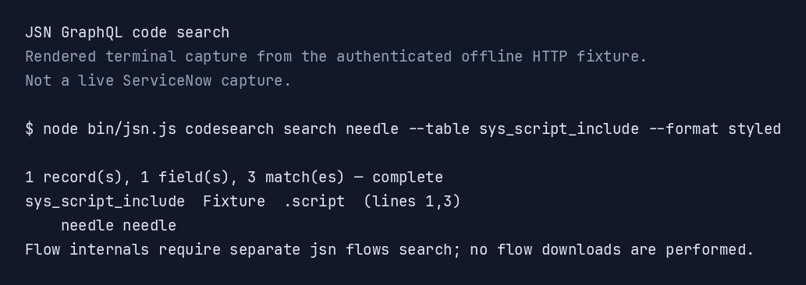

# Code search (GraphQL)

```sh
jsn codesearch search GlideAjax
jsn codesearch search Abstract --table sys_script_include --limit 2000 --json
jsn codesearch search current --table sys_script --scope x_my_app --max-pages 40
jsn codesearch search script --table sys_variable_value --get data.coverage
```

The backend is exclusively read-only `query { GlideRecord_Query { ... } }`
requests sent with `POST /api/now/graphql` through the normal authenticated SDK.
There is no old `sn_codesearch` search endpoint fallback, eval, Flow download,
or instance configuration write. Cookie/session bootstrap and OAuth refresh
retain the SDK's normal behavior. Read-only profiles can use this command.

Flow internals require **`jsn flows search`** separately. Searching
`sys_variable_value.value` searches that table only; it does not decode or claim
to exhaust Flow definitions.

## Catalog and instance configuration

`cli/src/codesearch-catalog.js` is the explicit table/field catalog. Its historical
baseline is [Jace Benson's public issue #91](https://github.com/arnoudkooi/SN-Utils/issues/91),
not the SN Utils extension's maintained index. It covers scripts, dictionary
qualifiers/defaults, UI XML/HTML, portal widgets, email, transforms, variables,
and legacy workflow definitions. The historical `programmitc_content` typo is
corrected to `programmatic_content`; script includes include `description`, and
widgets include CSS. Historical active-only filters are deliberately not copied:
inactive source can still be relevant. There is no universal table-schema claim;
plugins, releases and permissions vary.

Every selected field is validated by GraphQL itself, even for empty results.
An explicit `Cannot query field` validation error permits searching the remaining
fields, but records the original requested fields and `unsupportedFields` and
keeps that table/report **partial**. Unknown tables are **unsupported**. Omitted
or null field objects are a coverage failure, never an empty searchable field.
An ordinary present `{value: null}` is an empty value. Access denials abort the
command instead of being misrepresented as absent schema. This runtime validation
avoids a guessed static dictionary/ancestry model.

The command also reads `sn_codesearch_table` for the selected
`search_group.name`, layering its `search_fields` and `additional_filter` over
the catalog. `--search-group` remains accepted (default
`sn_devstudio.Studio Search Group`); it selects the **configuration overlay**, not
a replacement search engine. A configured custom table can be selected with
`--table`. Multiple configured filters for a table form alternative `NQ` branches;
each branch retains the term and explicit scope restriction. Missing/unreadable
configuration is disclosed as partial, so curated-only results are never labeled
complete. The configuration read is bounded to 1000 entries; overflow is partial.
Configured script expressions or ordering/control directives are refused for
that source, not executed or silently dropped. A terminal `^EQ` is normalized.

## Limits and coverage

The compatible row shape stays under `data.records`:
`table, name, field, lines, matches, context, sys_id`. There is one row per
matching record/field. `count` and `fieldCount` are row counts; `recordCount`
is distinct matching source records, and `matchCount` counts literal,
case-insensitive non-overlapping occurrences, not context lines. `lines` contains
only matching 1-based line numbers. The first matching line is a compact excerpt
(up to 240 characters); full source is not returned by the command.

JSON, CSV, Markdown, styled, quiet, auto, and `--get` use the existing output
controller. `_formatted` is non-enumerable and is not part of machine data.
Styled output includes counts, coverage warnings, and the separate Flow-search
hint. CSV retains the established flat row schema; use JSON or `--get data.coverage`
for detailed completeness evidence. Empty output means no **visible** matches
in the searched population, not proof that inaccessible artifacts do not exist.

| Option | Default | Meaning |
| --- | --- | --- |
| `--limit`, `-l` | 100 | Maximum matching records (not field rows) |
| `--page-size` | 250 | Requested offset window; maximum 1000 |
| `--max-pages` | 20 | Pages per table; maximum 1000 |
| `--max-requests` | 1000 | Data requests including configuration and schema retries; maximum 10000 |

The request count measures SDK data calls, not extra HTTP requests for normal
SDK authentication, session bootstrap or recovery. Those keep their existing
SDK bounds and timeout behavior.

Windows advance by the **requested page size**, never by returned count.
Short pages do not establish completion. An empty page establishes exhaustion
of the visible, stable query. IDs must be present, unique and strictly increasing
under `ORDERBYsys_id`; duplicates or reversed IDs make the table partial.
The result is not a transactional snapshot: concurrent edits/deletes and
ACL-hidden records remain provider visibility limits. There is no fabricated
provider total or claim of ACL-independent completeness.

`status` is `complete` only when every selected table exhausted without gaps or
unsupported fields and configuration was readable. Limits, malformed responses,
transport/provider errors, omitted fields and unstable pagination are reported
under `coverage` with fetched counts, page counts and reasons. All-unsupported
searches report `unsupported`; mixed supported/unsupported searches report
`partial`. Partial/unsupported reports are successful envelopes with explicit
states; authentication/authorization failures are nonzero command errors.
GraphQL `errors` inside successful HTTP/result envelopes are checked explicitly.
Reaching the record limit is conservatively partial, even if the final returned
record happened to be the last match.

`--scope` always restricts results; `--no-all-scopes` requires explicit `--scope`
rather than silently using an unknown current application. Table/field names
must be identifiers. Terms are literal (not regex or encoded queries). Carets,
newlines, NUL and `javascript:` are rejected before transport because encoded
queries have no reliable literal escape for those controls. Quotes/backslashes
are JSON-escaped inside the GraphQL query string.

## Verification

Offline injected-transport tests and a local authenticated HTTP fixture exercise
paging, budgets, schema/access failures, configured custom fields/filters,
read-only profiles, literal safety, occurrence counts, every format and extraction:

```sh
cd cli
node --test test/codesearch.test.js
cd ..
npm test
npm run lint
```

The following image renders verbatim stdout from that authenticated offline
fixture test. It is not live-instance evidence.



The implementation worker does not run instance probes. Live acceptance should
compare the same fields/term/scope against independently paginated Table API
reads, including the final empty GraphQL window. The operator's existing evidence
shows why short pages cannot terminate paging and why `description` must be
included when comparing script includes. Those earlier probes are protocol
evidence, not proof that every table or this final revision passed live.
