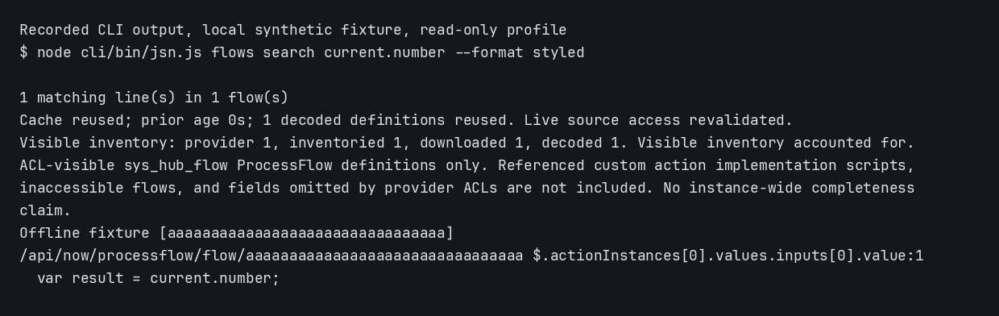

# Flow definition search

```sh
jsn flows search 'current.number'
jsn flows search 'approval' --refresh
jsn flows search 'current.number' --json
jsn flows search 'current.number' --get data.matches
```

`flows search <term>` is separate from normal code search. First use automatically downloads visible Flow Designer definitions and decodes them. POSIX systems write a private local cache; Windows searches in memory only. It never prompts, publishes, executes, creates or updates flows. Read-only profiles are supported.

Search is case-insensitive literal text. Each result identifies the flow name and sys_id, ProcessFlow source endpoint, JSON source path and line within that string value. Counts describe matching lines and distinct matching flows, not occurrences. Text and scripts are not truncated. JSON, extraction, styled, Markdown and CSV use the normal output writer.

## Cache and authorization

On Windows, disk caching is disabled because Node permission bits do not verify private Windows ACLs. Every invocation (including `--refresh`) downloads and decodes live definitions in memory. Reports explicitly return `cache.state: disabled`, `file: null`, zero reused definitions and a reason; human output explains the tradeoff. No cache paths are created, read, modified or followed, including existing symlinks/junctions/reparse points. Any cache left by an earlier version is **not secured or deleted**: remove old sensitive files manually using a trusted path. This avoids an external ACL-tool dependency but forfeits decoded-cache reuse on Windows. Live search, source authorization, coverage and output formats are unchanged.

On POSIX systems, the cache lives under `$XDG_CACHE_HOME/jsn/flow-search`, or `~/.cache/jsn/flow-search`. Names are SHA-256 digests of instance origin, selected profile, username, authentication method and domain. Directories have mode 0700 and files 0600; symlink files and unsafe permissions are refused. Files contain readable definition strings and source digests, not authentication credentials. Treat cached source as sensitive. Removing that directory clears the cache.

Warm searches reuse decoded definitions whose current source hash is unchanged. `--refresh` discards that decoded cache and rebuilds it. Reports include prior cache age, capture time and reused-definition count.

**Warm searches still contact the instance and download each definition to revalidate source access.** Profile names and role lists cannot prove unchanged ACLs, field permissions or impersonation state. No cached text is returned for a source whose fresh read fails, and changed sources are decoded again. This deliberately trades network savings for protection against stale privileged source. Offline search is not provided. No verified provider permission-version contract was found that would safely permit offline reuse after permissions change.

## Sources and coverage

The inventory uses paginated `sys_hub_flow` Table API reads, ordered by sys_id, and strict Stats API counts checked before and after pagination. Short pages do not end pagination. Missing arrays, duplicate identities, page safety limits, missing counts and count mismatches are reported rather than treated as complete empty results. Enumeration is limited to what the current account can see. An ACL may hide flows or fields without enumerating them as failures, so this is never an instance-wide completeness claim.

Definitions come from the existing `GET /api/now/processflow/flow/<sys_id>` contract used by `flows show`. Plain string values remain readable. Base64-gzip JSON strings beginning with `H4sI` are recursively decoded with the existing SDK `decodeGzipJson` implementation. Malformed compressed values fail that flow's decode instead of silently indexing only the remaining fields. Definitions with no recognized structure arrays are unsupported and reported as decode failures. There is no speculative alternative decompressor or table-field fallback. An older instance without ProcessFlow support is reported as unavailable rather than pretending legacy metadata is a complete definition.

The report distinguishes provider count, inventoried flows, downloaded definitions and decoded definitions. Every observed download/access/decode failure includes its flow identity and stage. `complete_visible_inventory` means every inventoried flow decoded, pagination exhausted, provider counts agreed and no observed failure occurred. It does not prove every possible field was visible. Referenced reusable custom action implementation scripts are not expanded; only text returned in each flow definition is searched. An empty result with partial coverage does not establish absence.

## Verification



Offline fixture tests exercise genuine gzip-encoded provider-shaped values, readable script extraction, deliberate corruption, cold/warm/refresh behavior, cache context isolation, permission revocation, secure file permissions, pagination and partial coverage. The fixture script is synthetic, not copied from an instance or another product. CLI subprocess tests use a local HTTP provider and a read-only profile to exercise the actual parser, backend GET requests, JSON/extraction and human formats.

Live read-only acceptance remains an operator check: select a known flow with an inline script, verify that its ProcessFlow response contains that script at the reported path, run cold/warm/refresh searches from this checkout and compare inventory counts with the same account's Table/Stats visibility. Do not publish instance source or credentials in test fixtures or PR evidence.
