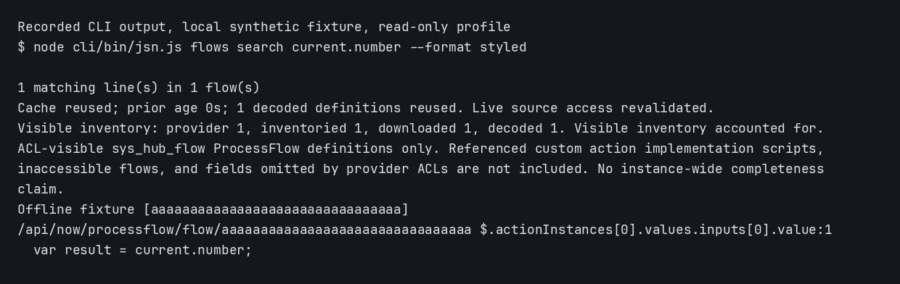

Inspect Flow Designer structures, search decoded flow definitions, clone a draft and inspect legacy workflows safely.

## Flow Designer interactive commands

For the partial draft-edit contract, preview, versioning, published-flow refusal
and instance evidence limits, see [Safe edits to existing flows](safety.md#safe-edits-to-existing-flows).
For native inactive-Draft duplication, supported graph boundaries and pending live
acceptance, see [Clone a flow](#clone-an-inactive-draft-flow).

## Terminal contract

Use a human terminal with `auto` output. Run `jsn actions create` or
`jsn flows create` without JSON data to start a wizard. Use
`jsn actions edit` or `jsn flows edit` to pick an existing target and edit it.

Record selection uses the shared paginated, searchable `interactiveList`.
Picker Escape, wizard Ctrl+C and refusing the final save return without writes.
Parent allocation, autosave, testing, publication and deletion do not occur
until the relevant confirmation. Explicit `--force` confirms existing mutation
commands, but does not bypass the creation wizard's final save confirmation.

`--json`, explicit non-auto formats, `--get`, `--data`, `--data-file`,
`--output-map`, pipes, `CI`, `NONINTERACTIVE` and `JSN_NO_PROMPTS=1` disable the
new wizard and target-picking paths. Missing required values produce a
`usage_error` JSON envelope with exit status 2 in JSON/auto-pipe mode. Existing
commands elsewhere retain their legacy usage-error rendering.

Explicit action definitions still go unchanged to the existing SDK lifecycle.
Explicit flow manifests still use the existing validation, GraphQL patch,
autosave versioning and readback. New scope selection offers the active raw
application ID before a scope picker and validates the selected ID. Existing
target scope checks remain unchanged. No credential, ACL, role or instance
setting changes are made by these wizards.

## Coverage matrix

`action` aliases `actions`; `flow` aliases `flows`. The rows below cover every
existing subcommand, including retained aliases.

| Command | Human terminal | Scripted path and safety | Local proof |
| --- | --- | --- | --- |
| `actions` | Existing command summary | Output controller summary retained | Command registration |
| `actions list`, `ls` | Existing searchable list/show picker | Existing query, fields and output behavior retained | Existing list tests |
| `actions show`, `get` | Omitted identifier picks an action | Explicit identifier unchanged; omission fails fast | Handler cancellation and binary usage checks |
| `actions definition` | Pick action, read full definition and executable steps | Exact scope inference/validation, read-only | PTY Escape; SDK definition/readback tests |
| `actions step-types` | Pick scope or accept its current raw ID | Explicit `--scope` remains supported, read-only | Real PTY scope picker; SDK endpoint test |
| `actions create` | Scope/name, live step schemas, typed inputs, script file/editor, script outputs, output mappings, final confirmation | Existing full JSON + explicit scope supported; fresh parent allocation and complete PUT; no publish/test | Real PTY successful creation, refusal and Ctrl+C; SDK-backed wizard unit tests with variables/mappings |
| `actions update`, `edit` | Pick action, load full saved definition; edit name/description, input defaults/required flags, output mappings, step inputs/scripts/mappings; confirm save | Supplied full definitions unchanged; target lifecycle identities and unknown nested fields retained | Real PTY script-file edit; SDK-backed preservation and cancellation tests |
| `actions test` | Pick action, prompt from saved input schemas, explicitly confirm execution | Explicit saved/supplied definition and output-map supported; force/confirmation and read-only guards; wait/output contract retained | PTY required input and refusal; dispatch argument tests; existing SDK wait/error/output tests |
| `actions delete` | Pick action, validate scope, confirm existing parent cleanup | Existing parent deletion plus exact absence readback; not a new native builder deletion lifecycle | PTY refusal; existing deletion scope/absence tests |
| `flows` | Output-controller command summary | JSON envelope instead of raw console output; no default mutation | Root output-envelope test and help checks |
| `flows list`, `ls` | Existing flow picker and inspection | Existing query/fields/depth and JSON behavior retained | Existing command/output tests |
| `flows executions`, `runs`, `contexts` | Existing executions report | Existing filtering/aggregation behavior unchanged; read-only | Existing execution/context tests |
| `flows executions show <context>` | One run's version, reporting level and failed step from `sys_flow_log` | Exact sys_id only, rejected before any request; read-only, bounded reads joined on raw sys_ids | `flow-execution-show.test.js` unit and loopback CLI tests |
| `flows show`, `get` | Omitted identifier picks a flow | Explicit name/ID inspection unchanged | Handler cancellation, binary usage and existing inspection tests |
| `flows status` | Pick flow and read readiness | Explicit identifier and diagnostic contract retained | Handler cancellation; existing status tests |
| `flows publish`, `activate` | Pick flow, or action with `--action`; explicitly confirm activation | Requires explicit force or existing profile skip-confirmations when prompts unavailable; lifecycle unchanged | PTY refusal; existing lifecycle/version readback tests with force |
| `flows test` | Pick flow, derive actual record-trigger table and provider display field, pick a record, confirm | Explicit identifier/record supported; no guessed table; read-only and execution confirmation retained | PTY record picker and refusal; trigger-table picker unit test; existing exact test-envelope tests |
| `flows settings` | Pick flow, or action with `--action`; show its execution setting and preview a reporting or logging change | Preview by default; `--yes` writes only changed fields and reads the row back; levels checked before any request; read-only profile refuses it | `flow-settings.test.js` handler tests |
| `flows doctor` | Existing read-only health report | No mandatory arguments added | Existing health-check tests |
| `flows create` | Name, scope, then trigger CATEGORY and trigger, then that trigger's declared inputs, then published action schemas and inputs, final confirmation | Every declared trigger input is written from the instance's own `sys_hub_trigger_input` rows; the trigger is INSERTED by the same patch as the actions; inactive Draft, Autosave and readback only | Real PTY category-then-trigger picker for the record and scheduled families, trigger/action/value readback and version; unit tests for catalog grouping, declared-input assembly, unsupported-family exclusion and cancellation |
| `flows update`, `edit` | Pick a flow (draft, or published/active with `security.can_write=true`), load saved definition; change trigger condition or an existing action input, confirm | Existing trigger/table/action-input update manifest retained; domain protects `jace-test-flow`; unspecified fields preserved; published snapshot and runtime pointers must be unchanged after the save | Real PTY confirmed trigger edit; input/type-discovery wizard tests; existing patch-preservation/version tests; published gate, snapshot-preservation, preview and lease-release regressions |
| `flows delete` | Pick a target, then report unsupported | Still unsupported; no GraphQL deletion invented | Omission/cancellation and read-only gates; unchanged unsupported handler |

## Limits and unverified behavior

This change has no live-instance write or execution evidence. All automated
persistence tests use disposable in-memory providers. PTY tests run real
Inquirer prompts and the real CLI adapter, and some traverse the real SDK
lifecycle, but that is not proof of ServiceNow persistence.

Independent live verification must use disposable actions/flows and read back
parent, executable steps, scripts, mappings, versions, runtime outputs and
update-set capture. Do not modify or run existing live flows/actions just to
verify this UX. Keep `jace-test-flow` protected.

The action wizard accepts provider step schema arrays and their `step_types` or
`stepTypes` envelopes. It does not supply a built-in guessed Script template.
Variable templates come from returned schemas. Scalar strings/references,
choices, numbers, booleans, document IDs, nested objects with child schemas and
scripts are guided. Other complex/secret types are not silently skipped; use a
complete JSON definition when the wizard reports an unsupported type. Provider
schema/version differences and configured external editors still need live
verification. Script-file UX is exercised in a real PTY; editor selection is
not an end-to-end editor-platform test.

Flow creation supports the trigger families this CLI has live-verified:
`record_create` / `record_update` / `record_create_or_update`, `daily` /
`weekly` / `monthly` / `repeat` / `run_once`, and `email` /
`knowledge_management` / `service_catalog` / `sla_task` /
`remote_table_query`. The picker's categories and members come from the
instance (`sys_hub_trigger_category` and each definition's own `category`
reference) intersected with that verified set, so a family that is offered is a
family that can actually be created; anything else is reported in
`trigger_guidance.excluded_families` rather than silently hidden. Each trigger's
inputs are read from `sys_hub_trigger_input` (the owning definition is the
`var__m_sys_hub_trigger_input_<definitionId>` name suffix) and every declared
input is written, using the instance's own default where the operator supplies
nothing. Predicate metadata is derived by the instance from the `condition`
input, not rebuilt by this CLI. Trigger/action persistence, input values and the
Autosave version have been read back from a live instance; publish/activation,
execution and deletion remain out of scope. Guided flow editing offers the
condition and existing action inputs, not every field that the scripted update
manifest supports. Flow Logic, subflows, variables,
error handling and native flow deletion remain unsupported. Action step
insertion/removal during guided edit is not implemented; use the existing full
JSON update path for schema-supported definition changes.

## Reproduce local verification

```bash
node --experimental-test-module-mocks --test test/flow-designer-interactive.test.js test/flow-designer-pty.test.js test/actions.test.js test/flows-command.test.js test/flow-create.test.js test/flow-test.test.js test/sdk-processflow-actions.test.js
npm test
npm run lint
git diff --check
node bin/jsn.js actions create --help
node bin/jsn.js flows edit --help
```

PTY tests require Python 3 and Unix PTYs and explicitly skip when unavailable.
Python is a test driver only, not a JSN runtime dependency. No dependencies,
package version or lockfile are changed.

## Flow definition search

```sh
jsn flows search 'current.number'
jsn flows search 'approval' --refresh
jsn flows search 'current.number' --json
jsn flows search 'current.number' --get data.matches
```

`flows search <term>` is separate from normal code search. First use automatically downloads visible Flow Designer definitions and decodes them. POSIX systems write a private local cache; Windows searches in memory only. It never prompts, publishes, executes, creates or updates flows. Read-only profiles are supported.

Search is case-insensitive literal text. Each result identifies the flow name and sys_id, ProcessFlow source endpoint, JSON source path and line within that string value. Counts describe matching lines and distinct matching flows, not occurrences. Text and scripts are not truncated. JSON, extraction, styled, Markdown and CSV use the normal output writer.

### Cache and authorization

On Windows, disk caching is disabled because Node permission bits do not verify private Windows ACLs. Every invocation (including `--refresh`) downloads and decodes live definitions in memory. Reports explicitly return `cache.state: disabled`, `file: null`, zero reused definitions and a reason; human output explains the tradeoff. No cache paths are created, read, modified or followed, including existing symlinks/junctions/reparse points. Any cache left by an earlier version is **not secured or deleted**: remove old sensitive files manually using a trusted path. This avoids an external ACL-tool dependency but forfeits decoded-cache reuse on Windows. Live search, source authorization, coverage and output formats are unchanged.

On POSIX systems, the cache lives under `$XDG_CACHE_HOME/jsn/flow-search`, or `~/.cache/jsn/flow-search`. Names are SHA-256 digests of instance origin, selected profile, username, authentication method and domain. Directories have mode 0700 and files 0600; symlink files and unsafe permissions are refused. Files contain readable definition strings and source digests, not authentication credentials. Treat cached source as sensitive. Removing that directory clears the cache.

Warm searches reuse decoded definitions whose current source hash is unchanged. `--refresh` discards that decoded cache and rebuilds it. Reports include prior cache age, capture time and reused-definition count.

**Warm searches still contact the instance and download each definition to revalidate source access.** Profile names and role lists cannot prove unchanged ACLs, field permissions or impersonation state. No cached text is returned for a source whose fresh read fails, and changed sources are decoded again. This deliberately trades network savings for protection against stale privileged source. Offline search is not provided. No verified provider permission-version contract was found that would safely permit offline reuse after permissions change.

### Sources and coverage

The inventory uses paginated `sys_hub_flow` Table API reads, ordered by sys_id, and strict Stats API counts checked before and after pagination. Short pages do not end pagination. Missing arrays, duplicate identities, page safety limits, missing counts and count mismatches are reported rather than treated as complete empty results. Enumeration is limited to what the current account can see. An ACL may hide flows or fields without enumerating them as failures, so this is never an instance-wide completeness claim.

Definitions come from the existing `GET /api/now/processflow/flow/<sys_id>` contract used by `flows show`. Plain string values remain readable. Base64-gzip JSON strings beginning with `H4sI` are recursively decoded with the existing SDK `decodeGzipJson` implementation. Malformed compressed values fail that flow's decode instead of silently indexing only the remaining fields. Definitions with no recognized structure arrays are unsupported and reported as decode failures. There is no speculative alternative decompressor or table-field fallback. An older instance without ProcessFlow support is reported as unavailable rather than pretending legacy metadata is a complete definition.

The report distinguishes provider count, inventoried flows, downloaded definitions and decoded definitions. Every observed download/access/decode failure includes its flow identity and stage. `complete_visible_inventory` means every inventoried flow decoded, pagination exhausted, provider counts agreed and no observed failure occurred. It does not prove every possible field was visible. Referenced reusable custom action implementation scripts are not expanded; only text returned in each flow definition is searched. An empty result with partial coverage does not establish absence.

### Verification



Offline fixture tests exercise genuine gzip-encoded provider-shaped values, readable script extraction, deliberate corruption, cold/warm/refresh behavior, cache context isolation, permission revocation, secure file permissions, pagination and partial coverage. The fixture script is synthetic, not copied from an instance or another product. CLI subprocess tests use a local HTTP provider and a read-only profile to exercise the actual parser, backend GET requests, JSON/extraction and human formats.

Live read-only acceptance remains an operator check: select a known flow with an inline script, verify that its ProcessFlow response contains that script at the reported path, run cold/warm/refresh searches from this checkout and compare inventory counts with the same account's Table/Stats visibility. Do not publish instance source or credentials in test fixtures or PR evidence.

## Clone an inactive Draft flow

Status: draft feature; not live accepted. Native allocation and a separately user-operated Designer Force Save have been observed. They establish distinct copy, full-save and version-creation operations, not a completed CLI clone lifecycle.

```sh
jsn flows clone 'Source flow' --name 'My copied flow' --force --json
jsn flows copy <source_sys_id> --name 'My copied flow' --force --get data.flow.id
```

`clone` is canonical; `copy` is an alias with identical mutation, confirmation and read-only-profile guards. Omitting the source in a prompt-capable auto-format terminal uses the family's shared picker. An interactive invocation without `--name` uses `<source name> copy`. Automation must supply `--name`. A name collision in the source scope is refused, never overwritten. The collision read is repeated just before allocation, but the provider does not expose an atomic uniqueness guarantee.

Select a named, in-progress update set with an already aligned effective session before running the command. Clone does not switch applications or update sets. Both persisted capture selection and effective picker selection must match before allocation and remain unchanged afterward. The new flow stays in the source application scope, with its access, protection, domain and run-as policy preserved. Cross-scope copying and description changes are not offered.

### Supported graph and fail-closed boundaries

The initial contract supports inactive, nondeleted Draft flows with one record-create, record-update or record-create-or-update trigger and flat actions referencing published reusable definitions. It compares the complete accepted provider collections and preserved top-level inventory, including descriptions, conditions, scripts, typed inputs, parameter schemas, choice/default metadata, maps and action definitions. Native copy owns allocation and serialization; this command does not export a reduced manifest or reconstruct the graph.

Owned flow, database component and catalog-variable-model identities must be fresh. Flow-local UI identifiers can be preserved by native copy, or remapped together with their typed references. Only those explicit identity/ownership paths and complete typed input pills are remapped for comparison. A destination-only `compiledSnapshot` is treated as derived only for a flat published action when it equals both the unchanged reusable definition's identity and `actionTypeSysId`, and the source field is explicitly empty. This does not allow runtime-bearing sources or unrelated snapshots. Literal embedded IDs, scripts and arbitrary object keys must remain unchanged. Anonymous nested input/output schema children remain anonymous; identified schema children must receive fresh identities.

Nonempty stages, nested logic, subflows, flow variables, catalog variables, connection configurations, error handlers, runtime snapshots, unknown top-level fields and unknown component fields are refused before the native allocation. Embedded or script-based pill encodings are likewise refused. Unsupported categories are not omitted from a copy. Credentials, runtime history and execution snapshots are not submitted to the provider. Shared action/trigger/parameter definitions remain references, not cloned records.

### Verification and partial results

The implementation sends exactly one source-confirmed native Designer allocation request:

```text
POST /api/now/processflow/flow/{source}/copy?sysparm_transaction_scope={source-native-scope}
{"name":"requested unique name","scope":"source-native-scope"}
```

Designer 29.0.5 `copyFlowSaga`, `copyFlowServerCall` and `getCopyFlowServerModel` establish this contract. The response's `result.data` is the new sys_id. It is not a guessed GraphQL operation or a guessed create payload.

Success requires positive destination name/scope/provenance and inactive-Draft evidence, full accepted-definition comparison, fresh identities, an exact saved version with matching owned identities and input values, source-to-copy serialized version content/schema comparison, and an exact parent customer update whose parsed XML points at that version. Source definition SHA-256 digests must match before and after. The original saved-version content is read and checked before allocation. Capture polling uses bounded GETs only and never repeats allocation.

The capture receipt proves the exact parent XML and saved version pointer/content, not independent child-table XML portability or execution correctness. It does not publish, activate or execute the flow. A verification failure is an error, not a claim that allocation rolled back.

After allocation, failures retain the new flow sys_id and failed stage in the actual JSON error envelope. Ambiguous allocation responses report an uncertain outcome and source/name reconciliation instructions. No retry, delete or automatic cleanup is attempted. Reconcile a partial result before retrying.

### Evidence still required

After graph readback, completion checks the authenticated SDK user against the exact destination lease row and the Designer safe-edit status. Only positively owned leases permit a full native `PUT /api/now/processflow/flow`, followed by `POST /api/now/processflow/versioning/create_version` with `{item_sys_id, type:"Save", annotation:"", favorite:false}`. The save preserves the readable definition and instance input schemas; reusable action-definition inputs/steps are excluded as in the editor serializer. Before release it rechecks the same lease identity and owner, then uses GraphQL `safeEdit(delete:destination)` and verifies both status and lease-row absence. This deletes the edit lease, never the flow. The owned lease is also released after a native save failure; ambiguous or foreign ownership is a zero-save, zero-release refusal.

The retained native copy passes full GET-definition and serialized-version comparison. Two fixed record-trigger outputs (`current`/`document_id` and `table_name`/`table_name`) can omit the known `FlowDesignVariableMapper` serialization attribute; only that exact name/type/parameter relationship is normalized. Action-input mapper metadata and all other schema metadata remain strict. JSON object-key insertion order is ignored for source digests, but array order and authored values remain exact.

Live completion is still **not accepted**. The retained CLI allocation currently has no lease (`canUserEdit:false`, `currentEditor:null`, zero lease rows), so the authorized repair stopped before save/version/release rather than inventing ownership or acquiring a replacement. Independent GET-only readback proves the source and application/update-set context unchanged, the destination inactive Draft, and its graph/saved-version preserved; its parent XML still has an empty version pointer. The captured UI Force Save also demonstrated a predecessor/current-version mismatch. The exact-current-version XML gate remains strict: no empty or stale pointer is accepted. No new allocation or UI-owned-copy mutation was performed. Keep the PR draft until the native completion path and exact XML relationship are live verified.

The isolated `flow-clone-cli.test.js` acceptance scenarios run the real CLI against a loopback provider under normal `npm test`, so existing CLI CI executes them without secrets or untrusted live workflows. They prove parsing, aliases, guards, exact requests, readback verification and recovery behavior, not ServiceNow compatibility. No live acceptance workflow or completion files are changed by this feature.

## Legacy Workflow Editor inspection (read-only)

`jsn workflows` inspects existing **legacy Workflow Editor** workflows — the
`wf_workflow`, `wf_workflow_version`, `wf_activity`, `wf_transition` and
`wf_condition` records — for troubleshooting and migration evidence.

It is not an authoring tool. It never checks out, edits, publishes, discards or
deletes a workflow, and it never converts or executes one. Reading does not
require a checkout.

### `flows` is Flow Designer; `workflows` is the legacy editor

The two engines have separate records and separate commands:

| Command | Engine | Records |
| --- | --- | --- |
| `jsn flows …` | Flow Designer | `sys_hub_flow`, `sys_flow_context`, … |
| `jsn workflows …` | Legacy Workflow Editor | `wf_workflow`, `wf_workflow_version`, `wf_activity`, … |

`workflow` (singular) and `workflows get` are aliases for the same read-only
command; `flows` is unchanged and keeps its existing mutation surface.

### Commands

```bash
jsn workflows list --table incident                 # published + checked-out state per workflow
jsn workflows list --name approval --limit 50 --offset 50
jsn workflows show "Incident approval"              # published version, else newest
jsn workflows show <workflow_sys_id> --version <version_sys_id>
jsn workflows show "Incident approval" --json       # structured definition with every ID
jsn workflows show "Incident approval" --json --get data.activities.0.sys_id
jsn workflows show "Incident approval" --config     # content and activity types under numbered steps
jsn workflows show "Incident approval" --step 5     # full content and outgoing edges for step 5
jsn workflows show "Incident approval" --no-config  # skip activity variables/scripts
```

`show` accepts a workflow name, a `wf_workflow` sys_id, or a
`wf_workflow_version` sys_id. A name that matches more than one workflow is an
`ambiguous` error naming each candidate, never an arbitrary pick.

Selection is explicit in the output:

- `--version` — the requested version, which must belong to that workflow;
- otherwise the **published** version (the active one if several are marked
  published);
- otherwise the **newest** version, which is a draft or retired version.

`list` uses one-row lookahead with `limit`/`offset`; `has_more` is a fact about
the next row, not a guess. `show` bounds activities with `--limit` (default 200)
and reports `coverage.activity_sample.truncated` when the bound was reached.
A truncated sample never turns absent links into `dangling` claims — those are
reported as `outside_sample` instead.

### Human outline and structured output

Human output is an outline: workflow and version provenance, every version with
its published/checked-out status, numbered steps, exceptional transitions,
stages and integrity warnings. Record IDs stay in JSON. Without `--config`,
step content stays hidden. With `--config`, each step shows its activity type
when known and every nonempty configured element beneath it, sorted by field
name and aligned as `field: value`. Multiline values preview three lines;
individual lines preview at most 160 characters. Explicit omission markers
point to `--json` for the full value. Comment-only scripts retain per-step
omission notes rather than printing their bodies. There is no trailing
configuration section.

Configuration reads and the flat JSON `configuration` objects are unchanged;
`--no-config` still skips those reads unless `--step` is supplied. Rendering adds
no instance queries.

`--step N` selects one positive step number from the normal full-workflow
numbering. It implies configuration and prints every line and character without
preview limits, followed by all outgoing edges (including normally implicit
sequential edges). Loop membership and closing-edge destinations are disclosed
for that step. The step outline refers to numbered destinations; IDs inside scripts,
conditions and free text are preserved literally in human output.
Invalid or out-of-range step numbers fail with a usage error.
With `--json`, the normal envelope is retained while `activities`, `steps`,
`transitions`, and `transitions_by_activity` narrow to that step and its outgoing
edges. Loop and coverage metadata continue to describe the full inspected graph.

`--json` returns the same facts with stable field names, including:

- `workflow`, `versions[]`, `version`, and `selection.reason`;
- `activities[]` with `definition_id`, `definition_name`, `definition_status`,
  `position`, `parent_id`, `stage_id`, `conditions[]` and `configuration`;
- `transitions[]` with `from_id`, `to_id`, `condition_id`, `condition_status`
  and `status` (`ok`, `dangling`, `outside_sample`);
- `transitions_by_activity[]` with activity `sys_id`, `name`, and outgoing
  `transitions[]`, including empty groups. Groups sort by name then sys_id;
  edges sort by destination name then transition sys_id. The existing flat
  `transitions[]` is unchanged and duplicate edges remain distinct;
- `loops[]` with `members[]` (sys_id and name), `edges[]` (all internal SCC
  edges), and `entry_points[]` (members with incoming edges from outside);
- `integrity` — `missing_activity_definitions`, `unset_activity_definitions`,
  `dangling_transitions`, `unresolved_transition_conditions`,
  `dangling_start_activity`, `inaccessible`;
- `coverage` — per-component read state and whether the activity sample was
  truncated. `loops_found` counts observed SCC loops; `loop_detection_complete`
  is false if graph reads failed, activities were truncated, any transition read
  reached its bound, or any endpoint is outside the loaded activities.
  `transitions_truncated` records a reached transition bound and also makes
  overall `coverage.complete` false.

The outline groups transitions under source steps and marks loop-closing edges
with `↺`. There is no separate `▶ LOOPS` section. SCCs with multiple members and
self-loops both count; all internal SCC edges remain in JSON. Analysis uses
loaded rows only, with no additional queries or writes.

Complete graph detection is silent, whether loops exist or not. An incomplete
graph prints one short loop-detection warning, even if no cycle was observed.
Observed loop-closing edges remain visible in partial samples, but membership
and entry points may be incomplete. Missing conditions/configuration/type
definitions do not invalidate known graph topology; existing integrity warnings
remain separate. Consequently `coverage.complete` and `loop_detection_complete`
intentionally answer different questions (for example a dangling endpoint
invalidates loop completeness even when all component reads succeeded).

### Missing and inaccessible definitions are explicit

A denied or missing component is never rendered as empty data:

- HTTP 401/403 on a component becomes `inaccessible` with `http_status` in
  `coverage.components` and `integrity.inaccessible`, while the rest of the
  readable definition is still returned;
- a missing `wf_*` table is `unavailable` (layout difference, not an empty
  workflow);
- an activity whose `wf_element_definition` row was not returned is listed in
  `integrity.missing_activity_definitions` and has `definition_status: "missing"`;
- transitions or a start pointer that reference an activity outside the read
  set are listed rather than silently dropped.

### Definition inspection is not runtime history

Every response carries `definition_scope`: the selected version's **design-time
configuration**. This is not evidence that this version executed, and this
command does not read runtime contexts or history. A published version can
differ from the configuration that produced a past execution; treat migration
or troubleshooting conclusions accordingly.

### Supported platform layout and permissions

Supported legacy editor layout (field names follow the Workflow Editor schema,
also used by the reference `WorkflowManager` implementation):

| Table | Fields read |
| --- | --- |
| `wf_workflow` | `sys_id,name,table,description` |
| `wf_workflow_version` | `sys_id,workflow,name,table,published,active,checked_out,checked_out_by,checked_out_by.name,condition,condition_type,start,full_sequences,sys_created_on,sys_updated_on` |
| `wf_activity` | `sys_id,name,activity_definition,activity_definition.name,parent,stage,x,y,width,height,input` |
| `wf_condition` | `sys_id,activity,name,condition,order,else_flag,error,event,event_name,short_description,skip_during_generate` |
| `wf_transition` | `sys_id,from,to,condition` |
| `wf_stage` | `sys_id,name,value,order` (optional) |
| `sys_variable_value` | `document_key,variable.element,value` for `document=wf_activity` (activity configuration and scripts) |
| `wf_element_definition` | `sys_id,name,description,sys_class_name` |

Required permissions are read-only: read ACLs on the tables above, including
`sys_variable_value` for activity configuration and `wf_element_definition` for
activity-type names. Workflow designers/administrators normally have these;
without them the affected component is reported as `inaccessible`. No write ACL
or checkout is required.

All requests are Table API `GET`s. Authentication session bootstrap requests are
the only non-GET traffic; no record is created, updated or deleted.

### Validated instances

Synthetic graph tests cover DAGs, SCCs, self-loops, disjoint loops, duplicate
edges, branch-only loops and incomplete reads, with JSON and outline assertions.
Read-only checks with the host's authenticated `demo` profile also verified:

- Standard Change Proposal (`3452d5259f2002002920bde8132e7028`): 13 activities,
  15 transitions, one SCC loop; both edges returning to Change Manager Group
  Approval are included.
- Change Request - Standard (`9c55dac2cb200200d71cb9c0c24c9c83`): 10 activities,
  11 transitions, zero loops, with no loop summary in human output.
- On-Call: Assign by Acknowledgement per Rota
  (`ddfa60feb748230059e0b956ee11a937`): 65 activities, 103 transitions, one SCC
  loop; inspection completed normally.

All three reported complete graph detection. These checks validate the selected
definitions, not runtime execution or compatibility with every platform release;
no platform release version was established in these checks.

### Reuse from table-behavior discovery (#398)

`src/workflow-inspection.js` exports
`listPublishedWorkflowVersionsForTable(sdk, table, { limit })`. It reports the
published workflow versions whose `table` matches and explicitly states that it
does not discover script-started or condition-started workflows. Table-behavior
discovery can use it for the known table association without claiming a complete
automation inventory.
